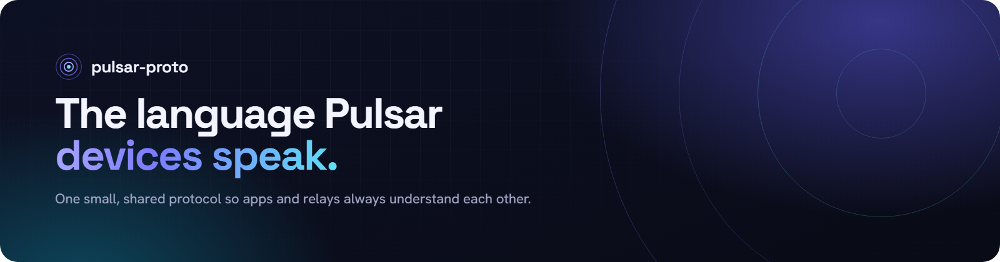
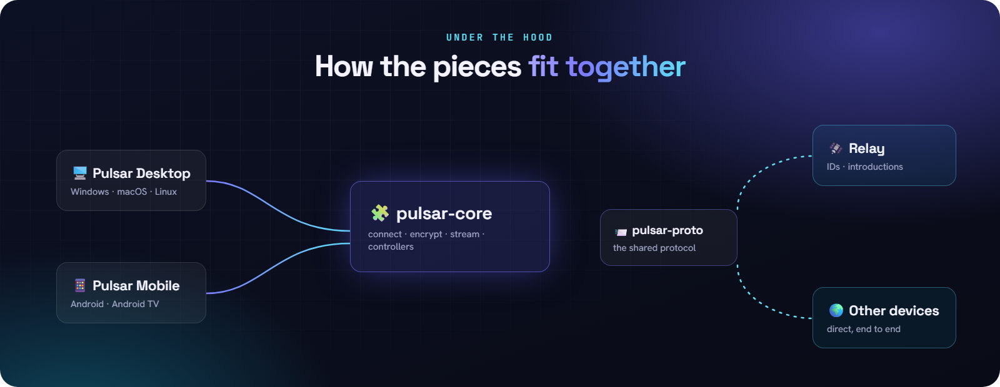

<p align="center">
  <a href="https://pulsardesk.com"></a>
</p>

<h3 align="center">The language Pulsar devices speak.</h3>

<p align="center">
  One small Rust crate that defines every message between the Pulsar apps and the relay server,<br>
  so the apps and the server always understand each other.
</p>

<p align="center">
  <a href="https://github.com/PulsarDesk/pulsar-proto/releases"></a>
  <a href="https://github.com/PulsarDesk/pulsar-proto/actions/workflows/ci.yml"></a>
  <a href="https://github.com/PulsarDesk/pulsar-proto/stargazers"></a>
  
  <a href="LICENSE"></a>
</p>

> [!TIP]
> **Looking for the app?** This is a library for developers. To use Pulsar, get
> **[Pulsar Desktop](https://github.com/PulsarDesk/pulsar-desktop)** (Windows, macOS, Linux) or
> **[Pulsar Mobile](https://github.com/PulsarDesk/pulsar-mobile)** (Android).

## 📨 Where it fits

<p align="center"></p>

[pulsar-core](https://github.com/PulsarDesk/pulsar-core) (inside both apps) and the
[relay](https://github.com/PulsarDesk/relay) both build on this crate. One shared definition means they can never
disagree about what a message looks like.

## 💬 What it describes

<table>
<tr>
<td width="33%" valign="top">

### 🪪 Who you are
Device IDs, registering with a relay, and the optional relay password and two-factor check.

</td>
<td width="33%" valign="top">

### 🤝 Finding each other
Asking the relay for a device, swapping addresses, and punching a direct path between two devices.

</td>
<td width="33%" valign="top">

### 🔁 Passing it on
Forwarding already-encrypted traffic when no direct path exists. The relay never sees what's inside.

</td>
</tr>
</table>

Messages are compact binary (bincode) and carry a protocol version, so a relay can turn away an app that is too old
instead of misreading it.

## 🛠️ Use it

```bash
git clone https://github.com/PulsarDesk/pulsar-proto.git
cd pulsar-proto
cargo test
```

```toml
[dependencies]
pulsar-proto = { git = "https://github.com/PulsarDesk/pulsar-proto" }
```

Pulsar is in **alpha** (0.x). Any change to a message is a protocol version bump across the relay, pulsar-core and
both apps.

## 🐞 Reporting a bug

Found a problem while **using** Pulsar? Report it in the app's repository
([desktop](https://github.com/PulsarDesk/pulsar-desktop/issues/new/choose) or
[mobile](https://github.com/PulsarDesk/pulsar-mobile/issues/new/choose)), or in the
[relay](https://github.com/PulsarDesk/relay/issues/new/choose) if it's about your own server.

## 🌌 The Pulsar family

| | Project | |
|---|---|---|
| 🖥️ | [**Pulsar Desktop**](https://github.com/PulsarDesk/pulsar-desktop) | Pulsar for Windows, macOS and Linux |
| 📱 | [**Pulsar Mobile**](https://github.com/PulsarDesk/pulsar-mobile) | Pulsar for Android phones, tablets and TVs |
| 🛰️ | [**Pulsar Relay**](https://github.com/PulsarDesk/relay) | Run your own Pulsar server |
| 🧩 | [**pulsar-core**](https://github.com/PulsarDesk/pulsar-core) | The shared engine behind both apps |

## 🤝 Contributing

Everyone is welcome to open [issues](https://github.com/PulsarDesk/pulsar-proto/issues) and pull requests.
Irrelevant or abusive issues may be closed or removed. Commits follow
[Conventional Commits](https://www.conventionalcommits.org).

## 📄 License

Pulsar is free software under the **GNU GPLv3 or later** (GPL-3.0-or-later). See [LICENSE](LICENSE).

<p align="center">
  <br>
  <b>Like Pulsar? A ⭐ helps other people find it.</b>
</p>
